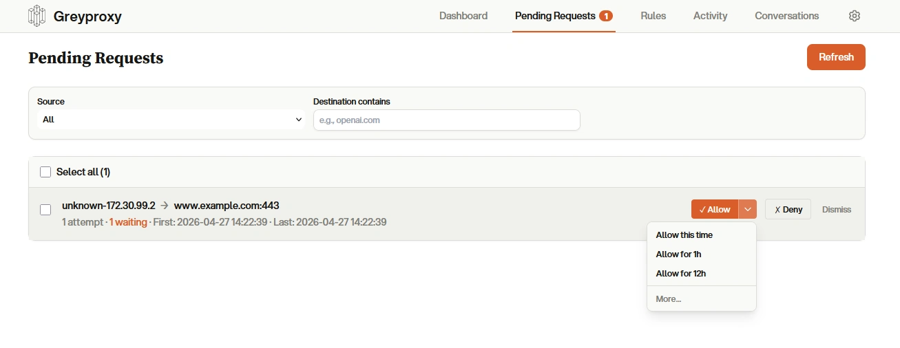
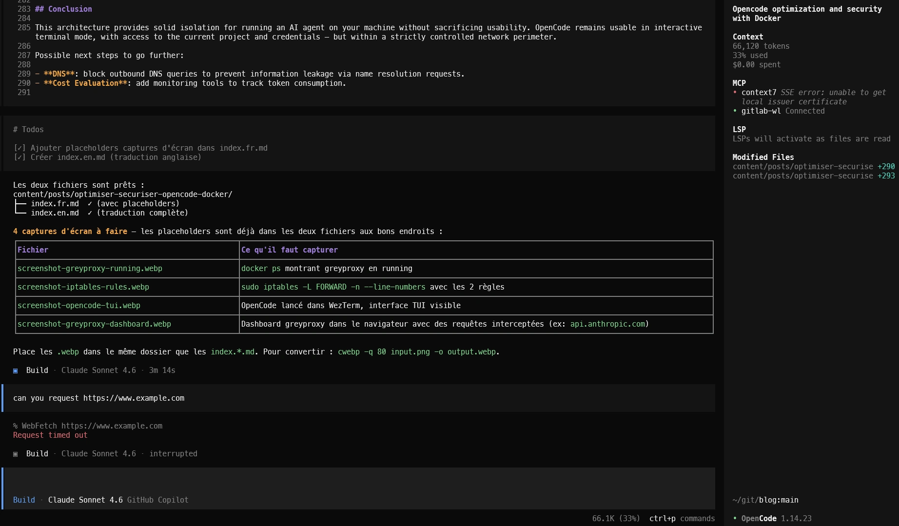

# TLDR

I use OpenCode (the open-source equivalent of Claude Code) as an AI tool in my terminal, but these tools can do just about anything — so I needed a way to limit and observe what they actually do.

The goal is also to isolate OpenCode to limit its impact if it goes off the rails.

Here are the mechanisms put in place:
- Filesystem isolation is handled by Docker (with volumes) — OpenCode only has access to the necessary directories (config, state, current project) and cannot escalate to root inside the container.
- Network isolation is achieved via:
  - A Docker network and iptables rules that block all outbound traffic except to greyproxy.
  - [Greyproxy](https://docs.greywall.io/greyproxy) lets you control and observe all of OpenCode's HTTP/HTTPS traffic through a dashboard where you approve network flows.

Greyproxy:
<!-- 📸 CAPTURE : dashboard greyproxy dans le navigateur montrant les requêtes interceptées (ex: api.anthropic.com, api.openai.com), ex: screenshot-greyproxy-dashboard.webp -->


The second aspect is token usage optimization with:
- [rtk](https://github.com/rtk-ai/rtk) which intercepts certain OpenCode commands (ls, cat, grep, git, ...) to reduce output.


# Optimizing and Securing OpenCode with Docker and greyproxy

## Context

OpenCode is an AI coding agent that runs locally. It calls external LLMs, reads and modifies files, executes shell commands — it could therefore potentially call a compromised site or install malware.

Concrete risks:

- **Data exfiltration**: OpenCode can make HTTP requests to the outside. Without controls, it could send source code or sensitive data to a malicious server.
- **System tampering**: OpenCode can modify system files or run dangerous commands, compromising the stability or security of the host machine.
- **Malware download**: OpenCode can download and execute binaries. A poorly worded prompt could lead to malware installation.

## Architecture

The architecture relies on two containers and iptables network rules on the host:

```
Host machine
│
├── Docker network: isolated_ai (172.30.99.0/24)
│   ├── greyproxy container  ← listens on host
│   └── opencode container   → HTTP_PROXY / HTTPS_PROXY → host IP:43051
│
├── iptables rules:
│   ├── FORWARD -s 172.30.99.0/24 -j DROP           (block all outbound traffic)
│   └── FORWARD -s 172.30.99.0/24 -d <host-ip> -j ACCEPT  (allow to proxy only)
│
└── Mounted volumes:
    ├── ~/.config/opencode/                    (configuration)
    ├── ~/.local/share/opencode/               (shared state)
    ├── ~/.local/share/opencode/auth.json :ro  (credentials read-only)
    ├── ~/.local/state/opencode                (logs / state)
    └── $PWD → $PWD                            (current project, same absolute path)
```

**greyproxy** acts as the single gateway: all of OpenCode's HTTPS traffic goes through it. It is the only exit point permitted by the iptables rules.

## Hands-on

### 1. The greyproxy container

greyproxy is a minimalist HTTP/HTTPS proxy by [GreyhavenHQ](https://github.com/GreyhavenHQ/greyproxy).

Among greyproxy's features:
- a live activity web dashboard that displays all intercepted requests in real time
- a dashboard showing pending requests
- a persistent rule set (Allow or Deny)

<!-- 📸 CAPTURE : dashboard greyproxy dans le navigateur montrant les requêtes interceptées (ex: api.anthropic.com, api.openai.com), ex: screenshot-greyproxy-dashboard.webp -->


I chose to run it in a Docker container, but this is purely optional — it can also run directly on the host.

Its Dockerfile is intentionally minimal:

```dockerfile
FROM alpine

RUN wget https://github.com/zyedidia/eget/releases/download/v1.3.4/eget-1.3.4-linux_amd64.tar.gz \
    && tar -xzf eget-1.3.4-linux_amd64.tar.gz -C /usr/local/bin/ --strip-components=1 \
    && rm eget-1.3.4-linux_amd64.tar.gz
RUN eget -k GreyhavenHQ/greyproxy --to=/usr/local/bin/

RUN addgroup jhanos -g 1000
RUN adduser -u 1000 -G jhanos -s /bin/sh -D jhanos

USER 1000

ENTRYPOINT ["/usr/local/bin/greyproxy"]
CMD ["serve"]
```

To build and start greyproxy:

```bash
docker build -t greyproxy .
docker run -d --name greyproxy --net host greyproxy
```


### 2. The isolated network and iptables rules

We create an isolated Docker network with no internet access. Without this network and its associated iptables rules, OpenCode could send traffic directly to the outside without going through greyproxy.

```bash
docker network create --subnet 172.30.99.0/24 isolated_ai
```

Then add two iptables rules on the host:

```bash
# Block all outbound traffic from the isolated network
sudo iptables -I FORWARD -s 172.30.99.0/24 -j DROP

# Allow only to the host IP (where greyproxy listens)
sudo iptables -I FORWARD -s 172.30.99.0/24 -d $(hostname -I | cut -d' ' -f1)/32 -j ACCEPT
```


### 3. The OpenCode container

I run OpenCode in a Docker container to benefit from filesystem isolation.

The OpenCode Dockerfile is more substantial — it is the full working environment. The user is called jhanos but feel free to change it:

```dockerfile
FROM ubuntu

ENV RUNNING_IN_DOCKER=true

# System dependencies
RUN apt update -yq && apt install -yq \
    bash curl git jq tree python3 unzip file sqlite3 openjdk-21-jdk \
    && apt clean

# eget — GitHub Releases binary manager
RUN curl -OL https://github.com/zyedidia/eget/releases/download/v1.3.4/eget-1.3.4-linux_amd64.tar.gz \
    && tar -xzf eget-1.3.4-linux_amd64.tar.gz -C /usr/local/bin/ --strip-components=1 \
    && rm eget-1.3.4-linux_amd64.tar.gz


# User hardening
RUN sed -i 's/^UID_MIN.*/UID_MIN 1000/' /etc/login.defs
RUN sed -i 's/^GID_MIN.*/GID_MIN 1000/' /etc/login.defs
RUN userdel ubuntu && groupadd jhanos -g 1000
RUN useradd -u 1000 -g 1000 -G tty -m -s /usr/bin/bash jhanos
RUN chown -R jhanos:jhanos ${ANDROID_HOME}

USER jhanos

RUN mkdir -p /home/jhanos/.cache /home/jhanos/.config \
    /home/jhanos/.local/share/opencode \
    /home/jhanos/.local/store/opencode \
    /home/jhanos/.local/bin/

RUN (curl -fsSL https://opencode.ai/install | bash -x) \
    && /home/jhanos/.opencode/bin/opencode -version

# rtk for token optimization
RUN eget rtk-ai/rtk --to ~/.local/bin/
ENV PATH="/home/jhanos/.local/bin:${PATH}"

# Proxy configuration via rtk
RUN rtk telemetry disable && rtk init -g --opencode

# Tools for my use (container + terraform)
RUN eget kyverno/kyverno -a cli -a ^pem -a ^sig --to ~/.local/bin/
RUN eget https://get.helm.sh/helm-v4.1.3-linux-amd64.tar.gz \
    -f linux-amd64/helm --to ~/.local/bin/

# Terraform
RUN eget https://releases.hashicorp.com/terraform/1.14.8/terraform_1.14.8_linux_amd64.zip \
    -f terraform --to ~/.local/bin/

CMD ["opencode", "--agent=plan"]
```

Security points to note:

**User hardening:**

```dockerfile
RUN sed -i 's/^UID_MIN.*/UID_MIN 1000/' /etc/login.defs
RUN sed -i 's/^GID_MIN.*/GID_MIN 1000/' /etc/login.defs
RUN userdel ubuntu && groupadd jhanos -g 1000
RUN useradd -u 1000 -g 1000 -G tty -m -s /usr/bin/bash jhanos
```

The default `ubuntu` user (present in the official Ubuntu image) is removed and a user with fixed UID/GID at 1000 is created. The `UID_MIN`/`GID_MIN` thresholds are explicitly set to prevent accidental creation of a system user with a low UID.


### 4. The launch command

Here is the full commented command:

```bash
# Make sure greyproxy is running
docker start greyproxy

# Remove any previous opencode container
docker rm opencode

# Apply iptables rules if missing
sudo iptables -L | grep -q "172.30.99.0/24" || (
  sudo iptables -I FORWARD -s 172.30.99.0/24 -j DROP
  sudo iptables -I FORWARD -s 172.30.99.0/24 -d $(hostname -I | cut -d' ' -f1)/32 -j ACCEPT
)

# Launch OpenCode
docker run --name opencode -it \
  --net isolated_ai \
  -e TERM=xterm-256color \
  -e TERM_PROGRAM=WezTerm \
  -e COLORTERM=truecolor \
  -v "${HOME}/.config/opencode/":/home/jhanos/.config/opencode/ \
  -v "${HOME}/.local/share/opencode/auth.json":/home/jhanos/.local/share/opencode/auth.json:ro \
  -v "${HOME}/.local/share/opencode/":/home/jhanos/.local/share/opencode/ \
  -v "${HOME}/.local/state/opencode":/home/jhanos/.local/state/opencode \
  -v "${PWD}":"${PWD}" \
  -u "$(id -u):$(id -g)" \
  -w $(pwd) \
  -e HTTP_PROXY=$(hostname -I | cut -d' ' -f1):43051 \
  -e HTTPS_PROXY=$(hostname -I | cut -d' ' -f1):43051 \
  -p 19876:19876 \
  opencode \
  /home/jhanos/.opencode/bin/opencode
```

Key options explained:

| Option | Role |
|---|---|
| `--net isolated_ai` | Connects to the internal network with no direct internet access |
| `-v auth.json:ro` | Credentials mounted read-only — OpenCode reads tokens but cannot modify them |
| `-v ${PWD}:${PWD}` | Project mounted with the **same absolute path** — tools that compute relative paths work correctly |
| `-u $(id -u):$(id -g)` | Runtime UID/GID injection — files created belong to the host user, not root |
| `-w $(pwd)` | Working directory matches the current project |
| `HTTP_PROXY` / `HTTPS_PROXY` | All HTTP(S) traffic goes through greyproxy on the host |
| `-p 19876:19876` | OpenCode web interface port |


Add this command as an alias in your `.bashrc` or `.zshrc`:
```bash
alias oc='docker start greyproxy; docker rm opencode 2>/dev/null; sudo iptables -L | grep -q "172.30.99.0/24" || (sudo iptables -I FORWARD -s 172.30.99.0/24 -j DROP; sudo iptables -I FORWARD -s 172.30.99.0/24 -d $(hostname -I | cut -d'"'"' '"'"' -f1)/32 -j ACCEPT); docker run --name opencode -it --net isolated_ai -e TERM=xterm-256color -e TERM_PROGRAM=WezTerm -e COLORTERM=truecolor -v "${HOME}/.config/opencode/":/home/jhanos/.config/opencode/ -v "${HOME}/.local/share/opencode/auth.json":/home/jhanos/.local/share/opencode/auth.json:ro -v "${HOME}/.local/share/opencode/":/home/jhanos/.local/share/opencode/ -v "${HOME}/.local/state/opencode":/home/jhanos/.local/state/opencode -v "${PWD}":"${PWD}" -u "$(id -u):$(id -g)" -w $(pwd) -e HTTP_PROXY=$(hostname -I | cut -d' ' -f1):43051 -e HTTPS_PROXY=$(hostname -I | cut -d' ' -f1):43051 -p 19876:19876 opencode /home/jhanos/.opencode/bin/opencode'
```


OpenCode:
<!-- 📸 CAPTURE : OpenCode lancé dans le terminal (WezTerm), interface TUI visible, ex: screenshot-opencode-tui.webp -->


### 5. Token optimization via rtk

[rtk](https://github.com/rtk-ai/rtk) is the tool for optimizing token usage.

`rtk init -g --opencode` configures OpenCode to use rtk via an OpenCode plugin.

It intercepts certain commands (ls, cat, grep, git, ...) to reduce the output sent to the LLM, saving tokens and speeding up interactions.

Example:
```bash
# ls -la (45 lines, ~800 tokens)        # rtk ls (12 lines, ~150 tokens)
drwxr-xr-x  15 user staff 480 ...       my-project/
-rw-r--r--   1 user staff 1234 ...       +-- src/ (8 files)
...                                      |   +-- main.rs
                                         +-- Cargo.toml
```


## Summary

| Layer | Mechanism | Effect |
|---|---|---|
| Network | Dedicated subnet | Dedicated network for OpenCode |
| Firewall | iptables DROP + targeted ACCEPT | Only traffic to greyproxy passes |
| Proxy | greyproxy | Single, observable exit point |
| Container | Non-root uid 1000 in both images | No privilege escalation |
| Credentials | `auth.json` mounted `:ro` | Tokens readable but not writable |
| UID at runtime | `-u $(id -u):$(id -g)` | Created files belong to the host user |
| Optimization | rtk | Reduced token usage |

## Conclusion

This architecture provides solid isolation for running an AI agent on your machine without sacrificing usability. OpenCode remains usable in interactive terminal mode, with access to the current project and credentials — but within a strictly controlled network perimeter.

Possible next steps to go further:

- **Token cost tracking**: add monitoring tools to measure LLM token consumption.
