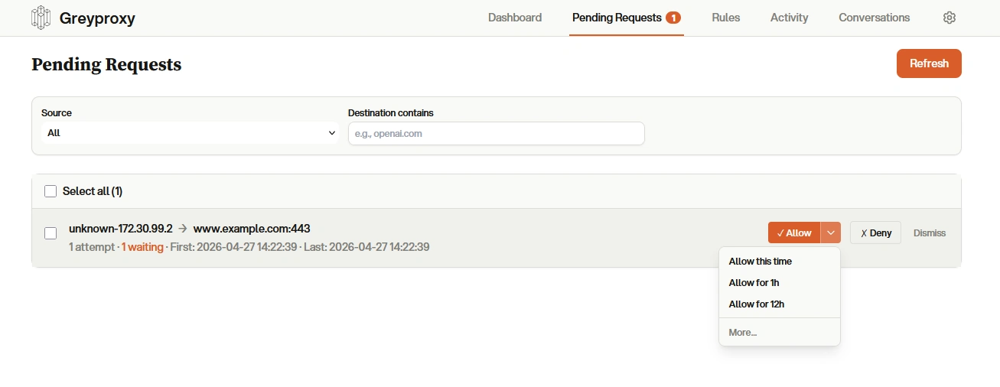
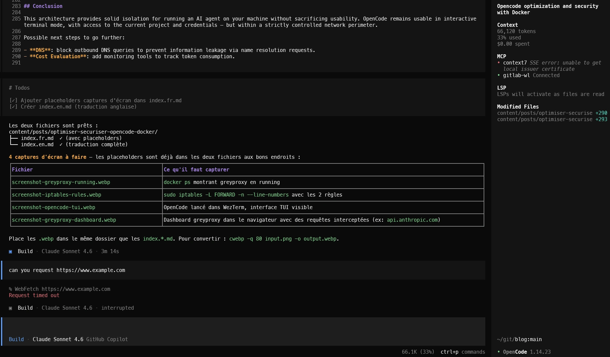

# TLDR

J'utilise Opencode (équivalent de claude code opensource) comme Outil d'IA dans mon terminal, mais ces outils peuvent faire tout et n'importe quoi donc j'avais le besoin de limiter et voir ce que font ces outils.

L'objectif est aussi d'isoler Opencode pour limiter son impact si il déraille.

Voici les mécanismes mis en place :
- L'isolation du filesystem se fait avec docker (et des volumes), opencode n'a accès qu'aux dossiers nécessaires (config, état, projet courant) et il ne peut pas passer root dans le container.
- L'isolation réseau se fait via :
  - un réseau docker et des règles iptables qui bloquent tout le trafic sortant sauf vers greyproxy.
  - [Greyproxy](https://docs.greywall.io/greyproxy) permet de contrôler et d'observer tout le trafic HTTP/HTTPS d'OpenCode via a dashboard où l'on accepte les flux réseaux.

Greyproxy:
<!-- 📸 CAPTURE : dashboard greyproxy dans le navigateur montrant les requêtes interceptées (ex: api.anthropic.com, api.openai.com), ex: screenshot-greyproxy-dashboard.webp -->


Le deuxième aspect est l'optimisation du nombre de token utilisé avec :
- [rtk](https://github.com/rtk-ai/rtk) qui intercepte certaines commandes d'OpenCode (ls, cat, grep, git, ...) pour réduire la sortie. 


# Optimiser et sécuriser OpenCode avec Docker et greyproxy

## Contexte

OpenCode est un agent de coding IA qui s'exécute localement. Il appelle des LLM externes, lit et modifie des fichiers, exécute des commandes shell, il peut donc potentiellement appeler un site corrumpu ou installer un malwhare.

Les risques concrets :

- **Exfiltration de données** : OpenCode peut faire des requêtes HTTP vers l'extérieur. Sans contrôle, il pourrait envoyer du code source ou des données sensibles à un serveur malveillant.
- **Alteration du système** : OpenCode peut modifier des fichiers système ou exécuter des commandes dangereuses, compromettant la stabilité ou la sécurité de la machine hôte.
- **Téléchargement de malwares** : OpenCode peut télécharger et exécuter des binaires. Un prompt mal formulé pourrait conduire à l'installation d'un malware.

## Architecture

L'architecture repose sur deux conteneurs et des règles réseau iptables sur l'hôte :

```
Machine hôte
│
├── Réseau Docker: isolated_ai (172.30.99.0/24)
│   ├── conteneur greyproxy  ← écoute sur hôte
│   └── conteneur opencode   → HTTP_PROXY / HTTPS_PROXY → IP hôte:43051
│
├── Règles iptables :
│   ├── FORWARD -s 172.30.99.0/24 -j DROP           (bloquer tout le trafic sortant)
│   └── FORWARD -s 172.30.99.0/24 -d <ip-hôte> -j ACCEPT  (autoriser vers le proxy)
│
└── Volumes montés :
    ├── ~/.config/opencode/                    (configuration)
    ├── ~/.local/share/opencode/               (état partagé)
    ├── ~/.local/share/opencode/auth.json :ro  (credentials en lecture seule)
    ├── ~/.local/state/opencode                (logs / état)
    └── $PWD → $PWD                            (projet courant, même chemin absolu)
```

**greyproxy** joue le rôle de passerelle unique : tout le trafic HTTPS d'OpenCode passe par lui. C'est le seul point de sortie autorisé par les règles iptables.

## Mise en pratique 

### 1. Le conteneur greyproxy

Greyproxy est un proxy HTTP/HTTPS minimaliste de [GreyhavenHQ](https://github.com/GreyhavenHQ/greyproxy).

Parmi les fonctionnalités de greyproxy, il y a :
- un dashboard web d'activité qui affiche toutes les requêtes interceptées en temps réel 
- un dashboard avec les requêtes en attente.
- un jeu de règles persistentes (Allow or Deny)

<!-- 📸 CAPTURE : dashboard greyproxy dans le navigateur montrant les requêtes interceptées (ex: api.anthropic.com, api.openai.com), ex: screenshot-greyproxy-dashboard.webp -->


J'ai fait le choix de le faire tourner dans un container Docker mais c'est purement optionnel, il peut aussi tourner directement sur l'hôte.

Son Dockerfile est volontairement minimal :

```dockerfile
FROM alpine

RUN wget https://github.com/zyedidia/eget/releases/download/v1.3.4/eget-1.3.4-linux_amd64.tar.gz \
    && tar -xzf eget-1.3.4-linux_amd64.tar.gz -C /usr/local/bin/ --strip-components=1 \
    && rm eget-1.3.4-linux_amd64.tar.gz
RUN eget -k GreyhavenHQ/greyproxy --to=/usr/local/bin/

RUN addgroup jhanos -g 1000
RUN adduser -u 1000 -G jhanos -s /bin/sh -D jhanos

USER 1000

ENTRYPOINT ["/usr/local/bin/greyproxy"]
CMD ["serve"]
```

Pour construire et démarrer greyproxy :

```bash
docker build -t greyproxy .
docker run -d --name greyproxy --net host greyproxy
```


### 2. Le réseau isolé et les règles iptables

On crée un réseau Docker isolé sans accès à l'internet, sans ce réseau et les règles iptables associées, OpenCode pourrait faire du trafic direct vers l'extérieur sans passer par greyproxy.

```bash
docker network create --subnet 172.30.99.0/24 isolated_ai
```

On ajoute ensuite deux règles iptables sur l'hôte :

```bash
# Bloquer tout le trafic sortant depuis le réseau isolé
sudo iptables -I FORWARD -s 172.30.99.0/24 -j DROP

# Autoriser uniquement vers l'IP de l'hôte (où écoute greyproxy)
sudo iptables -I FORWARD -s 172.30.99.0/24 -d $(hostname -I | cut -d' ' -f1)/32 -j ACCEPT
```


### 3. Le conteneur OpenCode

Je fais tourner OpenCode dans un conteneur Docker pour bénéficier de l'isolation du filesystem.

Le Dockerfile OpenCode est plus fourni — c'est l'environnement de travail complet, le user s'appelle jhanos mais libre à vous de le changer:

```dockerfile
FROM ubuntu

ENV RUNNING_IN_DOCKER=true

# Dépendances système
RUN apt update -yq && apt install -yq \
    bash curl git jq tree python3 unzip file sqlite3 openjdk-21-jdk \
    && apt clean

# eget — gestionnaire de binaires GitHub Releases
RUN curl -OL https://github.com/zyedidia/eget/releases/download/v1.3.4/eget-1.3.4-linux_amd64.tar.gz \
    && tar -xzf eget-1.3.4-linux_amd64.tar.gz -C /usr/local/bin/ --strip-components=1 \
    && rm eget-1.3.4-linux_amd64.tar.gz


# Durcissement utilisateur
RUN sed -i 's/^UID_MIN.*/UID_MIN 1000/' /etc/login.defs
RUN sed -i 's/^GID_MIN.*/GID_MIN 1000/' /etc/login.defs
RUN userdel ubuntu && groupadd jhanos -g 1000
RUN useradd -u 1000 -g 1000 -G tty -m -s /usr/bin/bash jhanos
RUN chown -R jhanos:jhanos ${ANDROID_HOME}

USER jhanos

RUN mkdir -p /home/jhanos/.cache /home/jhanos/.config \
    /home/jhanos/.local/share/opencode \
    /home/jhanos/.local/store/opencode \
    /home/jhanos/.local/bin/

RUN (curl -fsSL https://opencode.ai/install | bash -x) \
    && /home/jhanos/.opencode/bin/opencode -version

# rtk pour l'optimisation des tokens
RUN eget rtk-ai/rtk --to ~/.local/bin/
ENV PATH="/home/jhanos/.local/bin:${PATH}"

# Configuration proxy via rtk
RUN rtk telemetry disable && rtk init -g --opencode

# Outils pour mon usage (container + terraform)
RUN eget kyverno/kyverno -a cli -a ^pem -a ^sig --to ~/.local/bin/
RUN eget https://get.helm.sh/helm-v4.1.3-linux-amd64.tar.gz \
    -f linux-amd64/helm --to ~/.local/bin/

# Terraform
RUN eget https://releases.hashicorp.com/terraform/1.14.8/terraform_1.14.8_linux_amd64.zip \
    -f terraform --to ~/.local/bin/

CMD ["opencode", "--agent=plan"]
```

Points de sécurité à noter :

**Durcissement de l'utilisateur :**

```dockerfile
RUN sed -i 's/^UID_MIN.*/UID_MIN 1000/' /etc/login.defs
RUN sed -i 's/^GID_MIN.*/GID_MIN 1000/' /etc/login.defs
RUN userdel ubuntu && groupadd jhanos -g 1000
RUN useradd -u 1000 -g 1000 -G tty -m -s /usr/bin/bash jhanos
```

On supprime l'utilisateur `ubuntu` par défaut (présent dans l'image Ubuntu officielle) et on crée un utilisateur avec UID/GID fixe à 1000. Les seuils `UID_MIN`/`GID_MIN` sont explicitement fixés pour éviter toute création accidentelle d'utilisateur système avec un UID bas.


### 4. La commande de lancement


Voici la commande complète commentée :

```bash
# S'assurer que greyproxy tourne
docker start greyproxy

# Supprimer l'éventuel conteneur opencode précédent
docker rm opencode

# Appliquer les règles iptables si absentes
sudo iptables -L | grep -q "172.30.99.0/24" || (
  sudo iptables -I FORWARD -s 172.30.99.0/24 -j DROP
  sudo iptables -I FORWARD -s 172.30.99.0/24 -d $(hostname -I | cut -d' ' -f1)/32 -j ACCEPT
)

# Lancer OpenCode
docker run --name opencode -it \
  --net isolated_ai \
  -e TERM=xterm-256color \
  -e TERM_PROGRAM=WezTerm \
  -e COLORTERM=truecolor \
  -v "${HOME}/.config/opencode/":/home/jhanos/.config/opencode/ \
  -v "${HOME}/.local/share/opencode/auth.json":/home/jhanos/.local/share/opencode/auth.json:ro \
  -v "${HOME}/.local/share/opencode/":/home/jhanos/.local/share/opencode/ \
  -v "${HOME}/.local/state/opencode":/home/jhanos/.local/state/opencode \
  -v "${PWD}":"${PWD}" \
  -u "$(id -u):$(id -g)" \
  -w $(pwd) \
  -e HTTP_PROXY=$(hostname -I | cut -d' ' -f1):43051 \
  -e HTTPS_PROXY=$(hostname -I | cut -d' ' -f1):43051 \
  -p 19876:19876 \
  opencode \
  /home/jhanos/.opencode/bin/opencode
```

Explication des options clés :

| Option | Rôle |
|---|---|
| `--net isolated_ai` | Connecte au réseau interne sans accès internet direct |
| `-v auth.json:ro` | Credentials montés en lecture seule — OpenCode lit les tokens mais ne peut pas les modifier |
| `-v ${PWD}:${PWD}` | Le projet est monté avec le **même chemin absolu** — les outils qui calculent des chemins relatifs fonctionnent correctement |
| `-u $(id -u):$(id -g)` | Injection de l'UID/GID de l'hôte au runtime — les fichiers créés appartiennent à l'utilisateur hôte, pas root |
| `-w $(pwd)` | Le répertoire de travail correspond au projet courant |
| `HTTP_PROXY` / `HTTPS_PROXY` | Tout le trafic HTTP(S) passe par greyproxy sur l'hôte |
| `-p 19876:19876` | Port de l'interface web OpenCode |


Ajoutez cette commande en alias dans votre `.bashrc` ou `.zshrc` :
```bash
alias oc='docker start greyproxy; docker rm opencode 2>/dev/null; sudo iptables -L | grep -q "172.30.99.0/24" || (sudo iptables -I FORWARD -s 172.30.99.0/24 -j DROP; sudo iptables -I FORWARD -s 172.30.99.0/24 -d $(hostname -I | cut -d'"'"' '"'"' -f1)/32 -j ACCEPT); docker run --name opencode -it --net isolated_ai -e TERM=xterm-256color -e TERM_PROGRAM=WezTerm -e COLORTERM=truecolor -v "${HOME}/.config/opencode/":/home/jhanos/.config/opencode/ -v "${HOME}/.local/share/opencode/auth.json":/home/jhanos/.local/share/opencode/auth.json:ro -v "${HOME}/.local/share/opencode/":/home/jhanos/.local/share/opencode/ -v "${HOME}/.local/state/opencode":/home/jhanos/.local/state/opencode -v "${PWD}":"${PWD}" -u "$(id -u):$(id -g)" -w $(pwd) -e HTTP_PROXY=$(hostname -I | cut -d' ' -f1):43051 -e HTTPS_PROXY=$(hostname -I | cut -d' ' -f1):43051 -p 19876:19876 opencode /home/jhanos/.opencode/bin/opencode'
```


OpenCode:
<!-- 📸 CAPTURE : OpenCode lancé dans le terminal (WezTerm), interface TUI visible, ex: screenshot-opencode-tui.webp -->


### 5. Optimisation de token via rtk

[rtk](https://github.com/rtk-ai/rtk) est l'outil pour optimiser le nombre de token. 

`rtk init -g --opencode` configure OpenCode pour utiliser rtk via un plugin opencode.

Il intercepte certaines commandes (ls, cat, grep, git, ...) pour réduire la sortie envoyée au LLM, ce qui permet d'économiser des tokens et d'accélérer les interactions.

Example:
```bash
# ls -la (45 lines, ~800 tokens)        # rtk ls (12 lines, ~150 tokens)
drwxr-xr-x  15 user staff 480 ...       my-project/
-rw-r--r--   1 user staff 1234 ...       +-- src/ (8 files)
...                                      |   +-- main.rs
                                         +-- Cargo.toml
```


## Récapitulatif

| Couche | Mécanisme | Effet |
|---|---|---|
| Réseau | subnet dédié | Réseau dédié pour opencode |
| Pare-feu | iptables DROP + ACCEPT ciblé | Seul le trafic vers greyproxy passe |
| Proxy | greyproxy | Point de sortie unique, observable |
| Conteneur | Non-root uid 1000 dans les deux images | Pas d'escalade de privilèges |
| Credentials | `auth.json` monté `:ro` | Tokens lisibles mais non modifiables |
| UID runtime | `-u $(id -u):$(id -g)` | Fichiers créés appartiennent à l'utilisateur hôte |
| Optimisation | rtk | Réduction du nombre de tokens utilisés |

## Conclusion

Cette architecture offre une isolation solide pour faire tourner un agent IA sur sa machine sans sacrifier l'ergonomie. OpenCode reste utilisable en mode interactif dans le terminal, avec accès au projet courant et aux credentials — mais dans un périmètre réseau strictement contrôlé.

Les prochaines étapes possibles pour aller plus loin :

- **Calcul des tokens des LLMs** : ajouter des outils de monitoring pour calculer la consommation de token.

